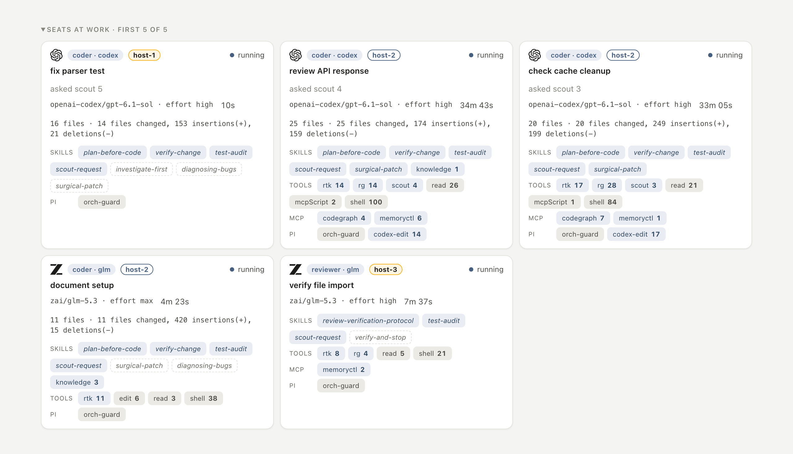
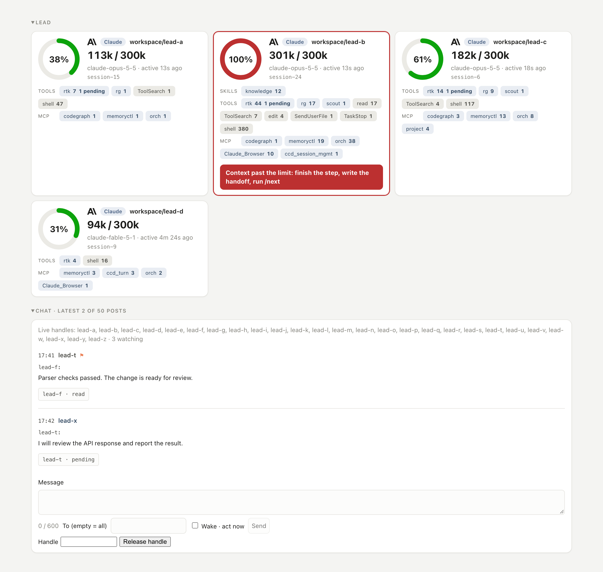
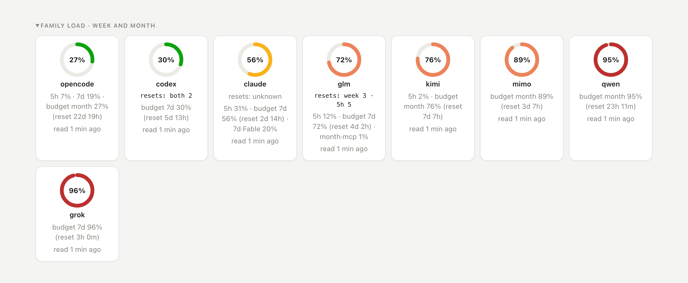

<picture>
  <source media="(prefers-color-scheme: dark)" srcset="img/banner-dark.svg">
  <source media="(prefers-color-scheme: light)" srcset="img/banner-light.svg">
  
</picture>

# BooHarness

[English](README.md) · [Руководство по установке](INSTALL.md) · [Промпт установки](INSTALL-PROMPT.md) · [Журнал изменений](CHANGELOG.ru.md) · [Лицензия](LICENSE)

BooHarness координирует агентов разных семейств моделей в локальной среде разработки. Сессия-лид планирует работу, выдаёт задания **исполнителям** (seats), читает их отчёты и коммитит принятые изменения. Харнесс запускает исполнителей, выделяет отдельные рабочие копии, задаёт правила ревью, хранит долговременную память и показывает ход работы на доске.

В конфигурации авторов **тимлидом выступает Claude в приложении Claude Code для компьютера**. Остальные семейства работают исполнителями под управлением orch. Claude Code тоже доступен как семейство исполнителей. Большинство исполнителей запускается в Pi через подписку своего семейства; исполнители Claude — в нативном Claude Code.

**Работа проверена только на macOS. На Windows харнесс не тестировали; неизвестно, установится ли там всё и будет ли работать весь процесс.**



## Назначение и аудитория

BooHarness предназначен для разработчиков и сопровождающих репозиториев, которые распределяют исследование, реализацию и ревью между моделями из разных подписок. Решения лида отделены от работы исполнителей: scout разбирает поток вызовов, coder вносит правку, reviewer проверяет результат, а лид решает, что принять в основную рабочую копию.

Инструменты и общие методы хранятся в каталоге харнесса, работа над проектами — в подключённых репозиториях. Подключение добавляет ссылки на навыки лида и строит индекс кода, не меняя отслеживаемые файлы проекта. Правила запуска, команды проверок и страницы знаний всё равно нужно настроить: BooHarness не выводит инженерные правила проекта из его исходников.

## Быстрый старт

Для установки рекомендуется **приложение Claude Code для компьютера с доступом к локальному терминалу**. Агент выполняет команды и открывает окна входа; владелец подтверждает изменения в системе и проходит авторизацию. Промпт установки:

```text
Клонируй https://github.com/alexboo86/booharness.git в ~/Developer/harness, если каталога ещё нет. Прочитай там INSTALL.md целиком и установи BooHarness по его инструкциям.
```


[INSTALL-PROMPT.md](INSTALL-PROMPT.md) задаёт порядок вопросов и установки. В [INSTALL.md](INSTALL.md) находятся команды и блоки проверки. Существующий каталог харнесса проверяется, а не перезаписывается. На чистом Mac до клонирования нужно установить Xcode Command Line Tools и проверить Git.

В ходе установки выбираются семейства, проверяется вход к провайдерам, настраиваются память и необязательные сервисы, подключаются интеграции рантаймов и проверяется состояние служб. Smoke-тесты расходуют запросы подписок и запускаются с согласия владельца. Ключи вводятся в локальном окне помощника, а не в чате агента. `npm run doctor` проверяет установленные части, ничего в них не меняя.

## Как это работает


1. **Подключение репозитория.** `node ops/kit/adopt-project.mjs /abs/path/to/project` добавляет ссылки на навыки лида и строит индекс codegraph. Инструкции проекта и команды проверок настраиваются после того, как заработает установка самого харнесса.
2. **Ограниченное задание.** Лид выбирает роль, указывает репозиторий и файлы, описывает ожидаемый результат. Незнакомый поток вызовов сначала может разобрать scout; coder получает уже согласованную задачу на реализацию.
3. **Выбор семейства.** Если семейство не указано явно, orch выбирает его из матрицы роли по темпу расхода квоты. Расход перечитывается регулярно. Недоступные семейства нужно ставить на паузу, а не оставлять среди кандидатов.
4. **Запуск исполнителя.** orch передаёт обязанности роли, задание, выбранные навыки и подходящие уроки. Coder, reviewer и bughunter получают отдельные git worktree. У ролей Pi только для чтения нет инструментов правки; обычно они работают в общей рабочей копии репозитория. `seat_create` с `needs`, равным `mac`, требует `needs_reason` не длиннее 300 символов (`ops/orchestrator/src/http.ts`), если только исполнитель не Claude, не нативный харнесс и не stand arm и ни один файл задания не лежит на настроенном пути только для Mac. `needs_reason` без этого `needs` отклоняется.
5. **Отчёт.** Исполнитель возвращает изменения, проверки, доказательства и оставшуюся работу в JSON. orch сохраняет и оценивает отчёт, не перезапуская проверки исполнителя, затем отдаёт лиду сводку. Оценка отчёта не доказывает правильность кода.
6. **Планирование и проведение ревью.** `review_plan` определяет необходимое ревью. Семейство рецензента отличается от семейства автора и лида, с одним исключением: Claude может проверять правку другого семейства, даже если лид — тоже Claude. Reviewer запускает тест только чтобы доказать собственное замечание, а не чтобы повторить прогон, который уже сообщил coder. Блокирующее замечание требует воспроизведения. Если два рецензента ссылаются на пересекающиеся строки одного файла, сводка помечает, что одно замечание ссылается на те же строки, что и другое; объединять их можно только когда они называют один дефект.
7. **Перенос правки и коммит.** `seat_land` переносит принятое изменение в рабочую копию лида, но никогда не коммитит. Лид коммитит явные пути через `npm run check:commit`, с разрешения владельца. Эта проверка запускает проверку безопасности коммита и те проверки, которые выбирают эти пути; она не запускает тесты orch, сборку комплекта и проверку истории знаний.
8. **Сохранение результата.** Решения записывает лид. Предложение урока от исполнителя видно в сводке и сохраняется только когда лид его применяет. Незавершённая работа становится задачами, а передача дел сохраняет состояние для следующей сессии.

Команды делегирования и правила выбора семейств описаны в [справочнике orch](ops/orchestrator/README.md) и [§9 руководства по установке](INSTALL.md#9-using-the-harness).

## Состав

### Демон orch и CLI

orch создаёт и отслеживает исполнителей, выбирает семейства, готовит worktree, собирает отчёты и обслуживает доску. Он работает локально как фоновая служба. API находится на `http://127.0.0.1:7760`, MCP — на `/mcp`, доска — на `/`; состояние хранится в SQLite с WAL в `~/.local/state/orch`.

Лид делегирует работу через MCP. CLI `node ops/orchestrator/src/main.ts` позволяет проверить службу, дождаться исполнителя, управлять хостами, запускать smoke-тесты и смотреть статистику выбора семейств. `wait <turn>` возвращает сводку завершённого хода. Удалённые хосты исполнителей подключаются по SSH; orch и лид остаются на основной машине. Если исполнителя может запустить несколько машин, машина, на которой работает orch, ранжируется после резерва в 6 ядер и 12 ГБ свободной памяти, не ниже нуля (`ops/orchestrator/src/placement.ts`); при равенстве выбирается хост. Fetch на удалённом хосте перематывает master этого клона вперёд только fast-forward, если ни один worktree не держит master извлечённым, у master нет коммитов, которых нет у remote, и master не символическая ссылка. Обход checkout на хосте сохраняет тот, где ещё есть неперенесённые правки, в том числе скрытые флагами assume-unchanged или skip-worktree, и удаляет checkout только через `git worktree remove` без `--force`.

### Доска и чат лидов

Веб-доска показывает лидов и занятый ими контекст, исполнителей с ролью, семейством и моделью, их инструменты, навыки и расширения Pi, а также окно квоты и темп расхода каждого семейства. Ожидающие и выполняющиеся задания видны без открытия всех переписок исполнителей.



Хуки доставляют сообщения чата лидов в работающую сессию. Отдельный наблюдатель может разбудить остановившегося лида, когда придёт сообщение. Чат и отчёты решают разные задачи: через чат лиды координируют работу, через отчёт исполнитель сдаёт результат.



### Роли и выбор семейства

Роль задаёт работу исполнителя и доступные методы; семейство — провайдера и модель, которые её выполнят. Матрицу ролей можно оставить штатной или настроить при установке.

| Роль | Задача |
|---|---|
| Scout | Найти код и ответить на ограниченный вопрос со ссылками на исходники. Scout не проводит замеры |
| Researcher | Исследовать тему и представить выводы с источниками |
| Coder | Реализовать согласованное задание и запустить нужные проверки |
| Tester | Воспроизвести дефект тестом и проверить пользовательский сценарий |
| Designer | Разработать дизайн или редизайн интерфейса по правилам проекта |
| Motion | Создать видео и анимацию на этом Mac через Higgsfield и ffmpeg-full; писать только в `web/apps/landing/public/media/**` и `web/apps/landing/_drafts/motion/**` |
| Copywriter | Написать тексты для пользователей, метаданные и строки локализации |
| Reviewer | Проверить изменение; запустить тест только чтобы доказать собственное замечание |
| Legal | Проверить правовые тексты, платежи, персональные данные и согласия |
| Security | Оценить угрозы и воспроизвести уязвимости в изменении |
| Bughunter | Исследовать и воспроизвести дефект |
| Debater | Разобрать конкурирующие подходы |
| Plan critic | Проверить предложенный план до реализации |

В комплекте нет навыков правовой проверки и редактуры в стиле продукта, поэтому Legal и Copywriter работают без доменного навыка, пока вы не добавите свой — для вашей юрисдикции или стиля текстов вашего продукта.

Выбор по квоте не означает, что одно семейство лучше остальных в любой задаче. orch читает расход у провайдеров раз в пять минут и предпочитает доступные семейства, которые не опережают свой бюджет. Учётные данные берутся из настроенных хранилищ провайдеров; нечитаемый лимит не доказывает наличие свободной квоты. Семейства без рабочего доступа нужно ставить на паузу.

### Pi и закреплённые расширения

[Pi](https://www.npmjs.com/package/@earendil-works/pi-coding-agent) — рантайм исполнителей всех семейств, кроме Claude. orch запускает его без автоматического поиска навыков и сам передаёт контекст задания. Так инструкции роли и набор инструментов остаются под контролем харнесса, а не загружаются вместе со всем штатным контекстом CLI провайдера.

#### Почему Pi

CLI провайдера загружает собственный системный промпт, каталог инструментов и навыки ещё до того, как исполнитель прочитает задание. Pi стартует без навыков, файлов контекста и телеметрии. orch передаёт навыки роли и уроки в первом сообщении.

Стенд от 2026-09-22: две задачи — scout отвечает на вопрос с проверкой по известному file:line, coder делает правку с тестом в одноразовом worktree. Каждое семейство запускали в его собственном CLI и в Pi, по два прогона. Среднее число токенов на задачу:

| Семейство | Scout: собственный CLI → Pi | Coder: собственный CLI → Pi |
|---|---|---|
| glm | 233k → 130k | 293k → 167k |
| grok | 175k → 33k | 339k → 109k |
| codex | 248k → 36k | 159k → 77k |
| opencode | 272k → 80k | собственный CLI не разрешал править файлы |

Корректность составила 100% в обоих вариантах. Задачи были небольшими, по два прогона на ячейку, чтение кеша включено в подсчёт; без него разница меньше. Это локальные замеры, а не гарантия результата.

В комплекте закреплён **Pi 1.4.0**. Он запускается из `ops/pi-runtime/node_modules/.bin/pi`, а не из глобальной установки.

| Интеграция | Назначение |
|---|---|
| Расширение orch | Ограничения инструментов исполнителя, в том числе защищённый shell для ролей только для чтения |
| `pi-mcp-adapter` 5.3.2 | Доступ к codegraph и памяти через MCP в виде инструментов исполнителя |
| `codex-edit`, `@maxiaochao/pi-toolkit` 0.9.3 | Расширение правки, обязательное для Codex в роли coder; закреплено по версии и хешу. Локальный замер, не гарантия: 2026-09-30, две небольшие задачи на правку одного файла, 10 прогонов на вариант: 10 из 10 корректны с расширением и без него; на 45% меньше токенов, вдвое меньше времени |

Установка расширения не даёт права произвольно подменять инструменты исполнителя. orch проверяет ожидаемый список инструментов; сторонняя замена shell или правки может нарушить этот контракт. Управляемая установка описана в [§7.3 руководства](INSTALL.md#73-pi-mcp-adapter-settings-sign-ins-codex-edit).

Исполнители Claude остаются в Claude Code. Пробы авторов с подпиской Anthropic через Pi завершались ошибками дополнительного расхода; этот маршрут не считается проверенным доступом по подписке.

### Worktree

Исполнители, которым нужна изоляция правок или проверки, работают в `~/.local/state/orch/worktrees/<seat>`. Каждый worktree относится к целевому репозиторию, а не к копии харнесса. Необязательные команды настройки проекта могут установить зависимости в новом worktree.

Изоляция разделяет параллельные правки, но не разрешает конфликты и не проверяет результат. Закрытие исполнителя останавливает процессы, чей рабочий каталог — worktree этого исполнителя, после остановки провайдера. Перенос изменений и коммит остаются разными операциями. Stash общий для всех worktree репозитория, поэтому хуки запрещают исполнителям `git stash`.

### Отчёты, оценка и ревью
В отчёте разделены наблюдения, доказательства, проверки и оставшаяся работа. Структуру оценивает код orch, и он не перезапускает проверки, которые исполнитель сообщил как пройденные: сообщённый провал помечается, как и критерий без команды или без результата. Черновик передачи дел помечает каждую сообщённую проверку как гипотезу. Необязательная оценка Jev отвечает на вопрос, является ли результат настоящим отчётом о завершении работы. Jev **не проверяет истинность каждой пары «утверждение — доказательство»**. Отчёт выше предела размера оценивается по копии, в которой обрезано каждое текстовое поле, а перечисления оставлены целиком; сам отчёт исполнителя из-за размера не отклоняется. Scout или researcher может вернуть инвентарь полем `table` (не больше 60 000 символов, `ops/orchestrator/src/report.ts`); оценка видит число строк, а не текст таблицы. Эти две роли не получают ход поддержки; неподдержанный blocker или major всё равно помечается в сводке.

План ревью учитывает собственный diff исполнителя и его риск. По этому плану правку проверяют независимые исполнители-reviewer. Reviewer запускает тест только чтобы доказать собственное замечание, а не чтобы повторить прогон, который уже сообщил coder. Если два рецензента ссылаются на пересекающиеся строки одного файла, сводка помечает, что одно замечание ссылается на те же строки, что и другое; это не доказательство одного дефекта. Если Jev недоступен, ревью не исчезает: планировщик сохраняет минимальное требование к числу рецензентов, более строгое для путей, связанных с безопасностью. Отправляемые данные и поведение при ошибках описаны в [разделе Jev](#jev).

### Проверка перед коммитом

Финальный коммит делает лид. Штатная команда `npm run check:commit` запускает проверку безопасности коммита из комплекта и те проверки, которые выбирают файлы коммита. Проверки всего корпуса (правовые тексты, переводы, повторяющиеся константы, циклы импорта и журнал Jev) запускаются только когда файл коммита входит в их входы (`scripts/check-commit.mjs` (not in this kit)). Она не запускает набор тестов orch, сборку комплекта и проверку истории знаний; это отдельные команды. Она не заменяет проверку типов, тесты и сборку подключённого проекта. Команды проекта нужно настроить при подключении. В комплекте также есть обёртки Git-хуков и проверка перед push; автоматически отправлять коммиты харнесс не будет.

### Память, уроки, задачи, передача дел и страницы знаний

`memoryd` — локальная служба долговременной памяти; `memoryctl` — её CLI и MCP-интерфейс. Хранилище сочетает SQLite, полнотекстовый поиск и векторы эмбеддингов. По умолчанию эмбеддинги строит Ollama с `qwen3-embedding:0.6b`; на macOS также устанавливается локальная модель переранжирования.

| Запись или страница | Назначение |
|---|---|
| Решения | Сохраняют согласованное правило или выбор за пределами чата, где он появился |
| Уроки | Возвращают прежнюю находку, когда работа затрагивает связанный файл или задачу |
| Задачи | Явно хранят незавершённую работу, чтобы она не терялась в итоговой сводке |
| Передача дел | Переносит выполненную работу, текущее состояние и открытые задачи в следующую сессию |
| Страницы знаний доменов | Хранят контекст подсистем в файлах репозитория; нужные материалы попадают в контекст агента |

У базы памяти один писатель. Для векторного поиска нужен работающий сервис эмбеддингов. В комплекте есть общие домены; страницы знаний и маршрутизация подключённого проекта настраиваются под него. Подробности — в [справочнике памяти](docs/agent/memory.md).

### Handover и моды Claude Code

Передача дел в памяти — долговременная запись. **Мод handover** переключает саму сессию: ставит в очередь промпт преемника, при необходимости после очистки старого разговора. Он не отменяет необходимость записать незавершённую работу.

Установщик регистрирует следующие моды Claude Code из `ops/claude-mods/`:

| Мод | Поведение и ограничение |
|---|---|
| `orch-board` | Открывает доску рядом с разговором. В приложении доступны карточки и формы, в терминале — текстовая сводка. Нужен локальный orch. |
| `handover` | Предоставляет `mcp__handover__run` для постановки промпта следующей сессии лида в очередь. Нужны API модов Claude. |
| `collision-guard` | Спрашивает перед правкой файла, который недавно менял другой открытый чат. Без подключённого интерфейса правка продолжается; это не блокировка файла. |
| `delay-no-more` | Управляет отложенным поиском инструментов по настроенным шаблонам `eager`/`defer`. Пустые штатные шаблоны ничего не меняют. |
| `secrets-veil` | Маскирует секретные значения в результатах инструментов и удерживает результат при ошибке маскирования. Распознавание любого возможного секрета не гарантируется. |


На изображениях — настоящий прогон с заменёнными личными именами. Регистрация каталогов модов не доказывает, что приложение их загрузило. Загрузка модов на Windows не проверена. Это моды Claude Code, а не расширения Pi или Codex.

### Codegraph, rtk и ast-grep

| Инструмент | Применение |
|---|---|
| `codegraph` | Индексирует связи кода и возвращает нужные исходники для вопросов о потоках вызовов, вызывающем коде и зависимостях; индекс проекта строится при подключении |
| `rg` | Ищет известный литерал; ответ графа не всегда самый дешёвый способ найти строку |
| `ast-grep` | Ищет структуру исходников, а не текст: например, реализации или вызовы заданной формы |
| `rtk` | Фильтрует вывод поддерживаемых shell-команд до попадания в контекст агента; `rtk gain` показывает измеренную экономию |

У инструментов разные задачи. Shell-хук направляет поддерживаемые команды через rtk; codegraph и память доступны также через MCP. Сокращение вывода не доказывает ни уменьшение общего расхода токенов на задачу, ни правильность результата.

### Навыки и хуки

Навыки — повторно используемые методы в файлах `SKILL.md`. Карта навыков задаёт набор лида, обязательные навыки ролей и навыки исполнителей по словам задания. Исполнители Pi получают их от orch, а не находят автоматически в произвольных каталогах. Добавление навыка включает проверку его инструкций и скриптов, сохранение лицензии и происхождения, регистрацию в карте и проверку доставки.

Хуки связывают методы с событиями рантайма: проверяют инструменты при старте, подают уроки перед работой с файлами, фильтруют shell-вывод, напоминают об инструментах анализа кода, доставляют чат лидов и напоминают о передаче сессии при заполнении контекста. Другие хуки запрещают исполнителям общий stash и рекурсивное принудительное удаление. Интеграции устанавливаются из исходников харнесса; повторный запуск установщика восстанавливает управляемые записи и при штатной политике сохраняет посторонние.

### Регулярные задачи, подключение проектов и doctor

- **Routines** — определения регулярных задач в `ops/routines/`. `node scripts/routines.mjs list` выводит список; навык `setup-routines` создаёт выбранные задачи через планировщик приложения лида. Сам просмотр списка ничего не планирует.
- **adopt-project** добавляет ссылки на настроенные навыки лида в репозиторий и строит индекс codegraph. Ссылки и индекс скрываются через `.git/info/exclude`; отслеживаемые файлы проекта эта команда не меняет. Правила запуска, проверки и знания доменов требуют отдельной настройки.
- **doctor** — диагностика установки без изменений, запускается командой `npm run doctor`. Она сообщает состояние частей, но не чинит их и не заменяет smoke-тест доступа к провайдерам.

## Jev

Jev — **необязательный платный классификатор и судья**, а не семейство для написания кода. Штатный клиент обращается к модели `jev-1.13.0` на `api.typesafe.ai`. Ключ `TYPESAFE_API_KEY` включает запросы; без ключа ничего не отправляется. При установке отдельно задаются вопросы о Jev и согласии на платную проверку.

| Интеграция | Что получает и решает Jev | Если оценить не удалось |
|---|---|---|
| Подбор уроков исполнителя | Задание, заголовки, привязки, условия применения и выдержки правил из кандидатов; ранжирует подходящие уроки | Сохраняется подбор по привязкам |
| Подбор навыков исполнителя | Задание, названия и описания навыков; может убрать кандидатов, но не обязательные навыки роли | Сохраняется выбор по карте навыков |
| Маршрутизация первого запроса лиду | Промпт лида и варианты доменов/навыков; выбирает контекст лида | Результат не выдаётся; повторная попытка остаётся возможной |
| Ограничение объёма задания coder | Размеченное задание; классифицирует объём и вероятности признаков | Задание помечается как неоценённое; автоматический выбор роли отказывает в создании исполнителя |
| План ревью | Собственный diff исполнителя с путями и фрагментами; оценивает риск логики и ослабление тестов | Сохраняется минимальное требование к ревью |
| Оценка отчёта | JSON-отчёт; определяет, настоящий ли это отчёт о завершении, а не истинны ли его доказательства | Отчёт остаётся без оценки, с указанием причины |
| Подсказка после отказа в команде | Текст запрещённой команды; выбирает подсказку из фиксированных вариантов инструментов | Подсказки нет; исходный отказ остаётся в силе |
| Глубокий поиск по памяти | Поисковый вопрос и заголовки/выдержки кандидатов с обработкой чувствительных данных; меняет порядок результатов | Команда завершается ошибкой, а не незаметно подменяет ранжирование |

Эти запросы могут передавать текст проекта за пределы машины: задания, содержимое отчётов и фрагменты diff. Jev не заменяет тесты, воспроизведение замечаний и решение лида. [Клиент](ops/bootstrap/jev-client.mjs) записывает аудиторский хеш каждого запроса; локальный журнал расхода используется для оценки затрат на доске.

## Семейства

Авторы используют Claude как лида в приложении Claude Code для компьютера. Лиды в терминальном CLI Claude Code и в приложении или CLI Codex тоже могут использовать сгенерированные конфигурации, но не получают те же интерфейсы модов Claude для компьютера.

| Семейство исполнителей | Маршрут рантайма | Доступ |
|---|---|---|
| `claude` | Нативный Claude Code | Авторизованный `claude` CLI |
| `codex` | Pi `openai-codex` | Подписка ChatGPT через Pi `/login` |
| `glm` | Pi `zai`; необязательный нативный маршрут через Claude CLI | Ключ Z.AI Coding Plan |
| `kimi` | Pi `kimi-coding` | Pi `/login` |
| `grok` | Pi `xai` | Pi `/login` |
| `opencode` | Pi `opencode-go` | Pi `/login` |
| `qwen` | Pi `qwen-token-plan-individual` | Ключ token-plan через Pi `/login` |
| `mimo` | Pi `xiaomi-token-plan-*` | Ключ token-plan через Pi `/login` |

Не каждое семейство доступно для каждой роли. В штатной матрице OpenCode работает только как scout. Claude доступен как researcher, coder, tester, designer, copywriter, motion, reviewer, plan critic и legal, но не как scout, debater, bughunter или security. Codex, glm, qwen и mimo покрывают все роли; у kimi есть все роли, кроме scout; у grok есть все роли, кроме bughunter и security. Motion использует матрицу семейств designer и работает только на этом Mac с локальной сессией Higgsfield и ffmpeg-full; запись ограничена `web/apps/landing/public/media/**` и `web/apps/landing/_drafts/motion/**` (`ops/orchestrator/src/profiles.ts`, `ops/orchestrator/src/role-policy.ts`, `ops/orchestrator/src/placement.ts`, `.agents/skills/motion-media/SKILL.md`). Coder семейства glm с effort max получает 60 минут, если лид не назвал предел времени; остальные исполнители сохраняют предел в 30 минут (`ops/orchestrator/src/seats-defs.ts`, `ops/orchestrator/src/seats.ts`). Полная матрица ролей и моделей, а также требования к входу находятся в [§2 INSTALL.md](INSTALL.md#2-supported-ai-families).

## Требования

- **macOS на Apple Silicon** — проверенная конфигурация. Для машин с ограниченной памятью есть [рекомендации по работе с 16 ГБ](INSTALL.md#113-16-gb-guidance).
- **Локальные инструменты:** Git из Xcode Command Line Tools; Node ≥ 26.7.0, ripgrep ≥ 15.1.0, Ollama ≥ 0.35.1. Руководство устанавливает зависимости из официальных архивов с проверкой контрольных сумм; менеджер пакетов для этого пути не нужен. Для модели переранжирования устанавливается Python.
- **Доступ к провайдерам:** рабочие подписки или ключи планов для включённых семейств. Для ревью нужно другое рабочее семейство; в руководстве практическим минимумом названы два семейства исполнителей помимо семейства лида.
- **Локальные службы и место на диске:** orch, memoryd, отвечающий сервис эмбеддингов, место для базы памяти, моделей и worktree проектов.
- **Необязательные сервисы:** Jev и Bright Data требуют собственных ключей. Для захвата экрана через Peekaboo на macOS нужны разрешения владельца.

На Windows харнесс не тестировали; неизвестно, установится ли там всё и заработает ли весь процесс. Наличие инструкций для Windows в руководстве не означает гарантии поддержки. Linux допустим как удалённый хост исполнителей, но не как машина для локальной установки памяти этим комплектом.

## Измеренные числа

| Наблюдение | Выборка и метод |
|---|---|
| **На 28,3% меньше токенов вывода инструментов с rtk** | `rtk gain`, 4 255 команд в сессиях оператора и исполнителей, 2026-10-20–21 |
| **56–73% контекста исполнителя уходит на чтение файлов** | Аудит токенов 583 исполнителей, 2026-09-21 |
| **3,183 против 78 токенов на один поиск точной строки** | Ответ codegraph с исходным кодом против `rg`; один запрос выполнен обоими способами, codegraph 1.6.2, cl100k_base, 2026-10-03 |
| **Поиск в памяти: hit@1 0.640, hit@5 0.757** | Качество поиска на работающем сервисе, бенч из 92 случаев, 214 запросов, 2026-10-06 |
| **0 токенов на запись в память** | Наблюдение за записью, 2026-10-05: строка сохраняется сразу, вектор строится в фоне |

Каждое число — локальный замер, а не гарантия результата. Замер rtk относится к выводу инструментов, а не к общему расходу токенов на задачу. `rtk gain` показывает собственную выборку установленной машины.

## Ограничения

- **Проверена только macOS. Windows не тестировали, результат неизвестен**, в том числе для загрузки модов.
- orch и лиды работают на одной машине; дополнительные машины запускают исполнителей по SSH.
- Выбор по квоте зависит от читаемого расхода у провайдеров. Рабочий вход или установленный рантайм сами по себе не доказывают, что исполнитель завершит задачу.
- У локальной памяти один писатель; векторный поиск зависит от сервиса эмбеддингов. Долговременные записи не создают страницы знаний проекта автоматически.
- Необязательные запросы Jev передают выбранный текст проекта третьей стороне. Отсутствие ключа и ошибки оценки имеют разные последствия в разных интеграциях, включая отчёты без оценки и отказ в автоматическом выборе.
- Названия моделей соответствуют дню сборки. Переименование у провайдера может сорвать запуск исполнителя и потребовать явного обновления модели или конфигурации.
- Манифест проверяет байты комплекта, а не работоспособность установки. Состояние служб, входы, smoke-тесты и загрузка модов приложения проверяются отдельно.
- Обещаний поддержки, гарантии и расписания обновлений нет. [§1.1 INSTALL.md](INSTALL.md#11-what-the-software-does-on-this-machine-tell-the-user-before-installing) описывает изменения на машине, [§14](INSTALL.md#14-what-the-kit-is-and-what-was-checked) — границы проверки.

## Документация

- [INSTALL.md](INSTALL.md) — команды установки, проверки и адаптация проекта
- [INSTALL-PROMPT.md](INSTALL-PROMPT.md) — порядок вопросов и установки с агентом
- [ops/orchestrator/README.md](ops/orchestrator/README.md) — справочник по оркестрации
- [docs/agent/memory.md](docs/agent/memory.md) — долговременная локальная память
- [docs/agent/environment.md](docs/agent/environment.md) — правила среды и инструментов
- [RTK.md](RTK.md) — каталог фильтров rtk

## Лицензия

[MIT с условием Commons Clause](LICENSE). Разрешены использование, копирование, изменение и распространение, в том числе на работе. Продавать BooHarness или платный сервис, ценность которого целиком или в основном основана на нём, нельзя. Это ПО с доступным исходным кодом, но не open source в смысле OSI. Заимствованные навыки со своим файлом `LICENSE` сохраняют его условия.
